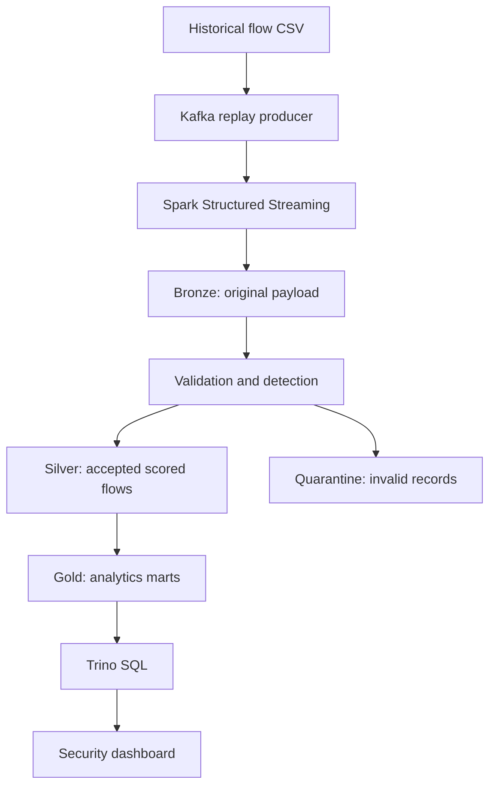

# CyberWatch

**Real-Time Network Intrusion Detection and Security Analytics**  
HUST · Big Data Storage and Processing · Harry Lebon-Barré

CyberWatch replays historical network-flow records, validates and scores them,
stores an auditable bronze/silver/gold history, and presents security indicators
in an interactive dashboard. It includes an actual Kafka → Spark Structured
Streaming → Iceberg → Trino implementation and a lightweight offline reference.

## Start here

**Windows / GitHub instructions in French:** [DEMARRER_ET_GITHUB_FR.md](docs/DEMARRER_ET_GITHUB_FR.md).

### 1. Offline demonstration — no Docker, no packages

Install **Python 3.10–3.12**, open a terminal in this folder, then run:

```bash
python run.py demo
```

Open **http://localhost:8000**. On macOS/Linux, use `python3` if necessary.
Stop with **Ctrl+C**. This mode generates 2,500 **synthetic** records and uses
transparent rules with SQLite. It does **not** pretend to run the distributed
engines. Its synthetic alerts are illustrative, not a detection benchmark.

### 2. Real data and the included trained model

```bash
python run.py download --mirror
python run.py ingest --file data/raw/test.csv --model artifacts/forest.json
python run.py serve
```

The public mirror is explicit and pinned by commit and SHA-256. The university
download currently redirects to a sign-in page. You can instead import official
CSV files manually; see [DATA.md](docs/DATA.md). The original 2.54-million-record
dataset is **not** bundled or automatically downloaded in full.

### 3. Full Big Data stack

Install Docker Desktop with Compose v2. Allow approximately **12 GB RAM** for
the services; **16 GB total system RAM or more** is a practical starting point.
Stop a locally running dashboard on port 8000 before starting Docker.

```bash
docker compose up -d --build
docker compose run --rm runner python run.py download --mirror
docker compose run --rm runner python run.py produce --bootstrap kafka:29092 --file data/raw/test.csv --rate 300
```

Open **http://localhost:8000**. Startup includes image and connector downloads;
the first build can take several minutes. The stream runs continuously. Gold
tables appear after the first successful micro-batch, so an initial “backend
unavailable” message before ingestion is expected. Check progress:

```bash
docker compose ps
docker compose logs --tail 80 stream
python scripts/query_trino.py
python scripts/stack_smoke.py
```

The smoke test adds 40 labeled synthetic diagnostic records; the dashboard
will report mixed data afterward. Do not treat these records as evaluation data.

Stop services, **keeping their persisted data**:

```bash
docker compose down
```

See [RUNBOOK.md](docs/RUNBOOK.md) for batch jobs, Spark ML, recovery and SQL.

## Architecture



Bronze, silver, quarantine and gold are real **Iceberg format v2 tables** backed
by S3-compatible RustFS storage. A persistent Iceberg REST/JDBC catalog is shared
by Spark and Trino. Spark batch and streaming jobs call the same transformations.

| Course concept | Implementation |
|---|---|
| L04 lakehouse | Iceberg bronze/silver/gold, partitioned silver, snapshot history |
| L07 interactive SQL | Trino queries the same Iceberg tables |
| L08 messaging | Kafka, three partitions, acknowledged producer delivery |
| L09 architecture | One streaming ingestion path with replay and batch backfills |
| L10/L11 processing | Spark DataFrames, batch entry point and Structured Streaming |
| L13 machine learning | Optional native Spark ML random forest; portable trained forest for serving |
| L14 integration | End-to-end pipeline, quality gate, retry-safe writes and serving |

## Detection and measured results

The included portable random forest was actually trained and evaluated on the
checksum-pinned UNSW-NB15 splits. Training rows sharing an **exact engineered
feature vector** with a held-out row were removed before fitting. Labels,
`attack_cat`, identifiers, addresses and split names are excluded from features.

| Metric | Included evaluation |
|---|---:|
| Original training records | 175,341 |
| Cross-split feature duplicates removed from training | 27,807 |
| Training records after deduplication | 147,534 |
| Held-out records | 82,332 |
| Precision | 0.8738 |
| Recall | 0.9448 |
| F1 | 0.9079 |
| ROC AUC | 0.9793 |
| Average precision | 0.9852 |

Exact metrics, hashes, confusion matrix, seed and library version are in
[reports/evaluation.json](reports/evaluation.json). This is the **scikit-learn
model**, distinct from native Spark ML. The separately implemented Spark
trainer was also exercised on 3,000 / 1,500 reservoir samples; its sample report
is included as `reports/spark_evaluation.json` (F1 about 0.8623).

Reproduce the included model:

```bash
python -m pip install -r requirements-ml.txt
python run.py train
```

Evaluation uses a fixed 0.5 threshold, with no threshold tuning on test labels.
Scores from the rules baseline are fixed risk indicators, **not calibrated
probabilities**. Historical lab data and completed flow records do not establish
live production effectiveness. The provided split files lack original
timestamps and addresses: replay time is flagged as simulated and addresses
stay null. See [REPORT.md](REPORT.md) and [DATA.md](docs/DATA.md).

## Validation

```bash
python -m unittest discover -s tests -p "test_*.py" -v
```

The native Spark/Iceberg integration test is documented in the runbook and runs
in a separate GitHub Actions job. It checks actual Iceberg commits, duplicate
replay, Structured Streaming, checkpoint restart and the quality gate.

**Execution evidence and boundaries:** [VALIDATION.md](docs/VALIDATION.md).
Docker orchestration and Trino must be validated with `scripts/stack_smoke.py`
on a machine with Docker; Work had no Docker executable.

## Repository map

| Path | Contents |
|---|---|
| `cyberwatch/` | Shared contract, ingestion, detection, training, server and dashboard |
| `jobs/spark_job.py` | Actual Spark batch / stream / native ML entry point |
| `docker-compose.yml`, `docker/` | Kafka, S3, REST catalog, Spark, Trino and dashboard |
| `artifacts/forest.json` | Portable trained forest, safe JSON format |
| `reports/` | Measured evaluation and validation evidence |
| `tests/` | Automated core and Spark/Iceberg integration tests |
| `sql/` | Analytics, provenance and Iceberg history queries |
| `docs/` | Architecture, data, execution and GitHub guides |

Raw/prepared datasets, runtime databases, checkpoints and Spark model directories
are excluded from Git. The trained JSON forest is only about 3.4 MB. The
repository should contain extracted project files, **not only this ZIP**.

## References

- [UNSW-NB15 official dataset and required academic citations](https://research.unsw.edu.au/projects/unsw-nb15-dataset)
- [Apache Spark 3.5.7 Kafka integration](https://spark.apache.org/docs/3.5.7/structured-streaming-kafka-integration.html)
- [Apache Iceberg Spark quickstart](https://iceberg.apache.org/spark-quickstart/)
- [Trino Iceberg connector](https://trino.io/docs/current/connector/iceberg.html)
- [GitHub: adding locally hosted code](https://docs.github.com/en/migrations/importing-source-code/using-the-command-line-to-import-source-code/adding-locally-hosted-code-to-github)

Use the dataset for academic work under its authors' terms. This repository
contains project code and derived evaluation evidence, not a relicensed copy of
the full dataset. See [NOTICE.md](NOTICE.md).
